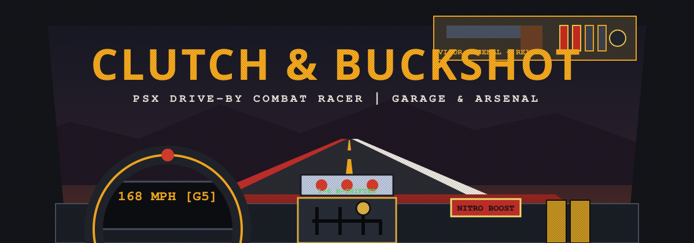

<div align="center">

# 🏁 CLUTCH & BUCKSHOT 💥
### *PSX Drive-By Combat Racer with 3D Perspective Pixel Cabin, Hinged Mechanic Bay & 8-Gun Armory*

[](https://thinkypadd.github.io/clutch-duck-and-buckshot/)
[](https://threejs.org/)
[](https://vitejs.dev/)
[](LICENSE)

<br/>

```
      ╔══════════════════════════════════════════════════════════════════════╗
      ║  [WHEEL] ◄── [3-8 SPD H-GATE] ──► [COLOR NITRO / VISOR ARSENAL]      ║
      ║  HOLD [A/D] PEEK OR TAP [Q/E] LOCK SIDE WINDOWS  |  LIVE MIRROR      ║
      ╚══════════════════════════════════════════════════════════════════════╝
```



</div>

---

## ⚡ Overview

**CLUTCH & BUCKSHOT** pairs a low-res **3D PSX world** in Three.js with a **true 3D perspective pixel-art cabin** built from angled pixel planes. Turning your head rotates inside the cockpit toward foreshortened Left and Right side doors instead of sliding flat sprites sideways.

You start with **`$0` cash**, a **`74 Rustbucket`** (`3-speed` junker, no Nitro, empty trunk), and an **`M1911 .45 Pistol`** on the visor. Your car accelerates automatically up to the speed band of your active gear while **1 mouse hand** handles steering, dynamic `3 -> 8` speed H-pattern shifting, overhead trunk traps, color-staged Nitro pulls, and manual gun reloads.

Wrecked rival cars burn permanently on the circuit for the rest of the race. Win by crossing the finish line 1st after 3 laps or by wrecking every rival on the track.

---

## 🎮 3D Pixel Cabin & Controls

```
  ┌────────────────────────────────────────────────────────────────────────────┐
  │ [⚙]  [TRUNK TRAP]   [LIVE 3D REARVIEW MIRROR]     [PASSENGER SUN VISOR]   │
  │      [OIL / MINE]   [◄ REAR PSX CAMERA FEED ►]    ┌───────────┬──────────┐ │
  │                                                   │ HOLSTERED │ AMMO     │ │
  │  ◄ [A] PEEK / [Q] LOCK           3D PSX           │ RELOAD    │ POUCH    │ │
  │    LEFT DRIVER DOOR             WINDSHIELD        └───────────┴──────────┘ │
  │    + SIDE MIRROR                                     RIGHT DOOR [D / E] ►  │
  │     ┌─────────────────┐     ┌───────────────┐                              │
  │     │ RPM | MPH | HP  │     │  CAR GIMMICK  │   [SHORT-THROW]  [N2O MOUNT] │
  │     └─────────────────┘     ├───────────────┤   [NITRO PULL]   ┌───┐ ┌───┐ │
  │       (STEERING WHEEL)      │ 1  3  5  7    │   GRN>BLU>RED    │N2O│ │N2O│ │
  │        Left Driver Side     │ ├──┼──┼──┼──┐ │   (+PURPLE MAX)  └───┘ └───┘ │
  │                             │ 2  4  6  8  R │                              │
  └─────────────────────────────┴───────────────┴──────────────────────────────┘
```

| Control | Input | Behavior |
| :--- | :--- | :--- |
| **Steering Wheel** | Mouse Drag (Left) | Rotates wheel; self-centers with road feedback when released. |
| **3-8 + R H-Shifter** | Mouse Drag (Center) | Auto-throttle climbs to active gear ceiling (`3` to `8` speeds per build). Downshift to engine-brake; `R` reverses. |
| **Live Rearview + Trunk** | Overhead Bezel & Switch | Watch tailgaters in the live rear PSX mirror and click the overhead switch to drop Oil, Caltrops, Mines, or Napalm. |
| **Color Nitro Handle** | Short Pull (Right) | Uninstalled at start. Upgrades unlock **Green** (Low), **Blue** (Mid), **Red** (High), and **Purple** (Rally Hatch Tier 3). |
| **Side-Window Look** | Hold `A`/`D` or Tap `Q`/`E` | Hold `A`/`D` for quick peek (`±79°`), or tap `Q`/`E` to lock Left/Right window view (`W`/`S` centers forward). |
| **Visor Arsenal** | Click & Drag (Top Right) | Unholster gun to aim and fire. Dock empty gun on visor for tactile manual reloads. |

---

## 🏛️ 5 Interactive 3D Hub Rooms

Every menu opens its own stationary 3D PSX room with manual drag-orbit, scroll-wheel zoom, preview-before-buy inspection, and permanent part ownership (swapping or downgrading owned parts is always free):

1. **Forecourt (`Main Menu`):** Active build parked outside the dusk garage bay.
2. **Race Briefing:** 3D topographic route table (`Canyon Pass` / `Badlands Flats`) and 3 League Tiers (`Scrapyard Cup`, `Street Outlaw`, `Syndicate Pro`).
3. **8-Bay Showroom:** Walk the lot of all 8 vehicles, inspect saved builds in 360°, buy, drive, or trade in owned cars for **70% value**.
4. **Mechanic Lift Bay:** Selecting any of the **9 upgrade slots** swings open the **hinged 3D Hood (with prop-rod), Driver Door, or Trunk Lid** and zooms the camera straight onto the subsystem before you buy.
5. **3D Gun Shop & Zoomable Workbench:** Click any of the **8 weapons** on the 3D pegboard wall and inspect **5 visual attachment slots** at `3x` pixel zoom.

---

## 🏎️ 8 Vehicles (`3 -> 8` Speeds & Cabin Gimmicks)

| Vehicle | Gearbox | Signature Gimmick |
| :--- | :--- | :--- |
| **74 Rustbucket** (`$0`) | `3 -> 4` Spd | **Choke Surge Knob:** Rich-fuel low-gear torque burst before engine heat spikes. |
| **86 Kuruma Coupe** (`$450`) | `4 -> 6` Spd | **Redline V-Cam:** Dash toggle adds `+18%` upper-RPM cam pull near redline. |
| **Baja Dune Buggy** (`$720`) | `4 -> 6` Spd | **Hydro-Jump + Sand Spec:** Zero off-road drag + hydraulic jump shocks to vault burning wrecks. |
| **V8 Interceptor** (`$980`) | `5 -> 6` Spd | **Blower Overdrive:** Supercharger switch (`+22%` torque) + `2.2X` heavy ramming damage. |
| **Iron Mule Ute** (`$1300`) | `5 -> 6` Spd | **Dual Visor Holsters:** Carries both Primary and Secondary weapons on the visor for 1-click hot-swaps. |
| **82 Rotary Coupe** (`$1680`) | `5 -> 7` Spd | **Twin-Pipe Backfire:** Ignites unburned exhaust fireballs to scorch tailgaters behind you. |
| **Apex Turbo Hatch** (`$2150`) | `6 -> 7` Spd | **Purple Nitro + Drift Lever:** Unlocks the 4th **Purple** Nitro stage (with Race N2O) + hydraulic drift lever. |
| **Valkyrie GT-X** (`$3100`) | `6 -> 8` Spd | **Active Aero Wing:** Motorized wing toggles between `+35%` Corner Grip and `+12%` Slipstream Top Speed. |

### 9 Visible Mechanic Upgrade Slots
- **Under-Hood Engine Bay:** `Engine Block` (I4 -> Twin-Cam -> V8 -> Gold Twin-Turbo V8), `Air Intake` (Pod -> Twin-Carb Scoop -> Chrome Bugcatcher Blower), `Cooling` (Copper Rad -> Front Oil Cooler + Braided Lines).
- **Interior Cabin:** `Gearbox` (`3..8`-speed gated H-shifters + live pixel gate diagram), `Nitrous` (Empty Bracket -> Green Bottle -> Blue Purge -> Twin Red/Purple Race Rig).
- **Rear Trunk Countermeasures:** `Empty Bay` -> `55-Gal Oil Drum` -> `Caltrop Chute` -> `Proximity Mine Rack` -> `Twin Napalm Tanks`.
- **Exterior Chassis:** `Window & Rollcage Armor`, `Front Ramming Bumper` (Push-Bar -> Bullbar -> V-Plow Wedge), `Tires & Aero` (Knobbies -> Slicks + Wing -> Run-Flats + Wheel Spinners).

---

## 🔫 8-Gun Arsenal & 6 Manual Reload Systems

- **M1911 .45 Pistol (`$0` Starter):** Drop spent mag -> drag fresh mag into well -> rack top slide.
- **Sawed-Off 12G (`$320`):** Break barrels -> flick 2 brass hulls out -> feed 2 shells -> snap shut.
- **.357 Magnum (`$580`):** Swing cylinder -> tap ejector rod -> load pairs (or **1-drag 6-shot Speedloader** at Loader Tier 2).
- **Trench Pump 12G (`$780`):** Thumb shells into bottom tube -> rack wood pump forend (unlocks hold-click **Slam-Fire** at Action Tier 2).
- **Viper 9mm SMG (`$950`):** Drop stick mag -> slap 24/36/50-round mag in -> pull top charging bolt.
- **Mares Leg .45-70 (`$1350`):** Feed heavy brass into brass side-gate -> cycle large-loop lever.
- **Draco 7.62 AK (`$1750`):** Rock curved/drum mag out -> lock fresh mag -> rip bolt carrier.
- **M79 40mm Thumper (`$2300`):** Break single 40mm tube -> pop casing -> seat high-explosive grenade (`11.5m+` blast radius).

> **Dev / Sandbox Shortcut:** Press `` ` `` (Backtick) or click the `GARAGE / SETTINGS` header 5 times inside the `[⚙]` modal to open the **Developer Sandbox** (`+$1k`, `+$10k`, `Unlock All`, `God Mode`, `Wreck All Rivals`).

---

## 🚀 Local Development

```bash
git clone https://github.com/thinkypadd/clutch-duck-and-buckshot.git
cd clutch-duck-and-buckshot
npm install
npm test
npm run dev
```

Open `http://localhost:5173` in your browser.

---

## 🏁 Live Deployment

GitHub Actions runs `npm test` and `npm run build` on every push to `main` and deploys to GitHub Pages:

👉 **[https://thinkypadd.github.io/clutch-duck-and-buckshot/](https://thinkypadd.github.io/clutch-duck-and-buckshot/)**
