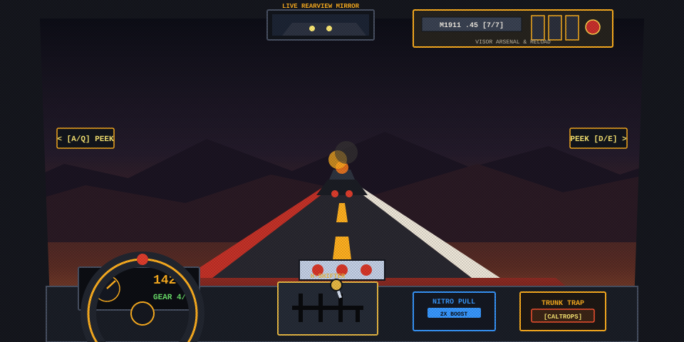
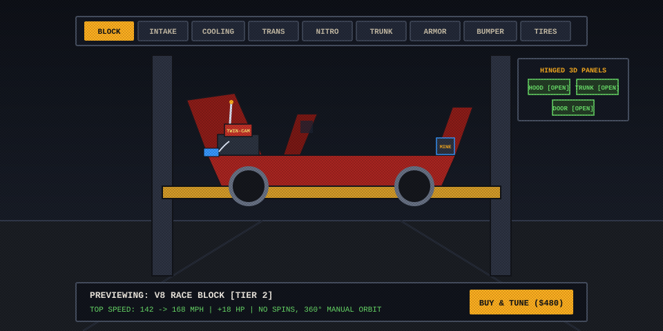
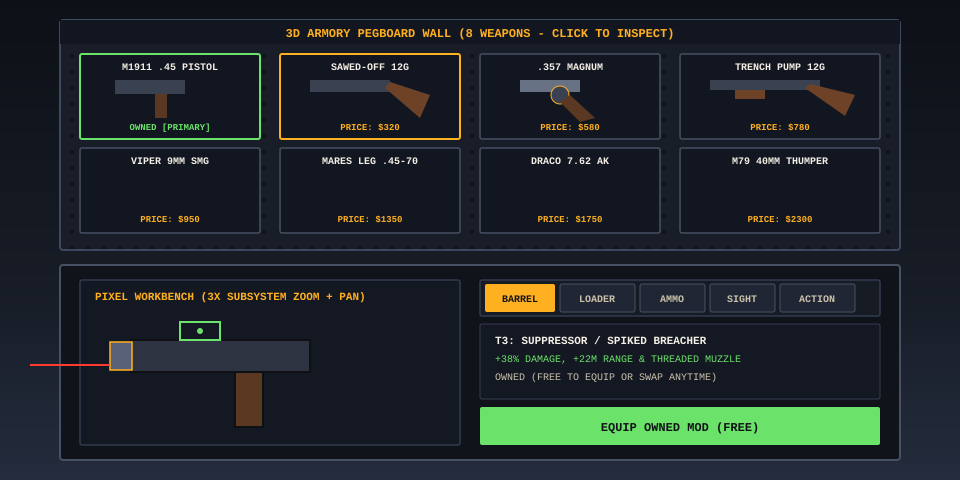

<div align="center">

# 🏁 CLUTCH & BUCKSHOT 💥
### *PSX Combat Racer with a 2D Perspective Cabin, Hinged Mechanic Bay & 8-Gun Armory*

[](https://thinkypadd.github.io/clutch-duck-and-buckshot/)
[](https://threejs.org/)
[](https://vitejs.dev/)
[](LICENSE)

<br/>

```
      ╔══════════════════════════════════════════════════════════════════════╗
      ║  [WHEEL] ◄── [3-8 SPD H-GATE] ──► [COLOR NITRO / VISOR ARSENAL]      ║
      ║  HOLD [A/D] PEEK OR TAP [Q/E] LOCK SIDE WINDOWS  |  LIVE MIRROR      ║
      ╚══════════════════════════════════════════════════════════════════════╝
```


</div>

---

## ⚡ Overview

**CLUTCH & BUCKSHOT** pairs a low-poly **3D PSX world** in Three.js with a **2D perspective cabin overlay**. You drive and fight with one hand on the mouse. Turning your head to the side windows brings the door into view while the forward dashboard recedes out of reach. Center your view to steer, shift gears, trigger dashboard abilities, or reload off the passenger sun visor.

You start with **`$0` cash**, a **`74 Rustbucket`** (a three-speed starter car with no nitrous and an empty trunk), and an **`M1911 .45 Pistol`** on the visor. Cars accelerate automatically up to the ceiling of their active gear. Wrecked rival cars remain burning on the circuit for the rest of the race. Win by finishing first after three laps or by wiping out every rival car on the track.

<div align="center">
  
  <p><em>In-race perspective cabin: round steering wheel, sliding H-gate, live rearview mirror, and passenger visor weapons.</em></p>
</div>

---

## 🎮 2D Perspective Cabin & Controls

The cabin uses native pixel proportions facing forward. Hold `A` or `D` to peek toward a side window, or tap `Q` or `E` to lock the view sideways for drive-bys (`W` or `S` returns forward). Looking sideways trades access to driving controls for a clear shot at flanking rivals. The windshield mirror and driver-side mirror stream live backward-facing PSX views of the race.

```
  ┌────────────────────────────────────────────────────────────────────────────┐
  │ [⚙]                [LIVE 3D REARVIEW MIRROR]     [PASSENGER SUN VISOR]   │
  │                    [◄ REAR PSX CAMERA FEED ►]    ┌───────────┬──────────┐ │
  │                                                   │ HOLSTERED │ AMMO     │ │
  │  ◄ [A] PEEK / [Q] LOCK           3D PSX           │ RELOAD    │ POUCH    │ │
  │    LEFT DRIVER DOOR             WINDSHIELD        └───────────┴──────────┘ │
  │    + SIDE MIRROR                                     RIGHT DOOR [D / E] ►  │
  │     ┌─────────────────┐     ┌───────────────┐                              │
  │     │ RPM | MPH | HP  │     │  CAR GIMMICK  │   [SHORT-THROW]  [TRUNK TRAP] │
  │     └─────────────────┘     ├───────────────┤   [NITRO PULL]   ┌───┐ ┌───┐ │
  │       (STEERING WHEEL)      │ 1  3  5  7    │   BLUE>PURPLE    │N2O│ │N2O│ │
  │        Left Driver Side     │ ├──┼──┼──┼──┐ │   (+PURPLE MAX)  └───┘ └───┘ │
  │                             │ 2  4  6  8  R │                              │
  └─────────────────────────────┴───────────────┴──────────────────────────────┘
```

| Control | Input | Behavior |
| :--- | :--- | :--- |
| **Steering Wheel** | Mouse Drag (Left) | Turns the car. Releases back to center with road chatter when let go. |
| **3-8 + R H-Shifter** | Mouse Drag (Center) | Shifts through gears (3 to 8 speeds depending on vehicle). Downshift to engine-brake into corners; slot `R` to reverse. |
| **Live Rearview + Trunk** | Windshield Mirror & Switch | Spot tailgaters in the live rear mirror and click the dashboard switch to drop Oil, Caltrops, Mines, or Napalm. |
| **Nitro Gauge & Pull Handle** | Short Pull (Right) | Bottle fill shows remaining pressure. Stacked stages step through **Blue** (1X), **Cyan** (2X), **Pink** (3X), and **Purple Overdrive** (4X, Apex Hatch with Race N2O). |
| **Side-Window Look** | Hold `A`/`D` or Tap `Q`/`E` | Hold `A`/`D` for a quick peek (`±79°`), or tap `Q`/`E` to lock the side view (`W`/`S` recenters). |
| **Visor Arsenal** | Click & Drag (Top Right) | Unholster gun to aim and fire. Dock empty weapon back on the visor to reload. |

---

## 🏛️ 5 Interactive 3D Hub Rooms

Menus open in stationary 3D rooms with manual drag orbit, scroll-wheel zoom, preview-before-buy inspection, and permanent part ownership (swapping or downgrading purchased parts is always free):

1. **Garage Forecourt (`Main Menu`):** Your active car parked outside the dusk garage bay.
2. **Race Briefing:** 3D topographic route table (`Canyon Pass` or `Badlands Flats`) and 3 League Tiers (`Scrapyard Cup`, `Street Outlaw`, and `Syndicate Pro`).
3. **8-Bay Showroom:** Inspect all eight vehicles in 360°, test-drive, buy, or trade in owned cars for **70% of total invested value**.
4. **Mechanic Lift Bay:** Selecting any of the **9 upgrade slots** swings open the **hinged 3D Hood (with prop rod), Driver Door, or Trunk Lid** and focuses the camera on the subsystem.
5. **Gun Shop & Workbench:** Select any of the **8 weapons** from the wall pegboard and preview **5 attachment slots** under 3x pixel zoom.

<div align="center">
  
  <p><em>Mechanic Workshop Bay: live 3D preview, hinged panels (hood, doors, trunk), and manual 360° orbit.</em></p>
</div>

---

## 🏎️ 8 Vehicles (3 to 8 Speeds & Dashboard Abilities)

| Vehicle | Gearbox | Signature Ability |
| :--- | :--- | :--- |
| **74 Rustbucket** (`$0`) | `3 -> 4` Spd | **Choke Surge Knob:** Rich-fuel low-gear torque burst before engine heat spikes. |
| **86 Kuruma Coupe** (`$450`) | `4 -> 6` Spd | **Redline V-Cam:** Toggle adds 18% upper-RPM cam pull near redline. |
| **Baja Dune Buggy** (`$720`) | `4 -> 6` Spd | **Hydro-Jump & Sand Spec:** Zero off-road speed penalty plus hydraulic jump shocks to vault burning wrecks. |
| **V8 Interceptor** (`$980`) | `5 -> 6` Spd | **Blower Overdrive:** Supercharger toggle adds 22% torque plus 2.2X ramming damage. |
| **Iron Mule Ute** (`$1300`) | `5 -> 6` Spd | **Dual Visor Holsters:** Carries primary and secondary weapons on the visor for one-click swaps. |
| **82 Rotary Coupe** (`$1680`) | `5 -> 7` Spd | **Twin-Pipe Backfire:** Ignites unburned exhaust fireballs to scorch tailgaters behind you. |
| **Apex Turbo Hatch** (`$2150`) | `6 -> 7` Spd | **Purple Nitro & Drift Lever:** Unlocks 4th **Purple** Nitro stage (with Race N2O) plus a hydraulic drift lever. |
| **Valkyrie GT-X** (`$3100`) | `6 -> 8` Spd | **Active Aero Wing:** Motorized rear wing toggles between 35% corner grip and 12% slipstream top speed. |

### 9 Visible Mechanic Upgrade Slots
- **Engine Bay (Under Hood):** `Engine Block` (I4, Twin-Cam, V8, or Twin-Turbo V8), `Air Intake` (Pod, Twin-Carb Scoop, or Chrome Bugcatcher Blower), `Cooling` (Copper Radiator or Front Oil Cooler with braided lines).
- **Cabin Interior:** `Gearbox` (3 to 8 speed gated H-shifters with pixel diagram), `Nitrous System` (Empty bracket, street bottle, purge kit, or twin race rig).
- **Rear Trunk Traps:** `Empty Bay`, `55-Gallon Oil Drum`, `Caltrop Chute`, `Proximity Mine Rack`, or `Twin Napalm Tanks`.
- **Exterior Chassis:** `Window & Rollcage Armor`, `Front Ramming Bumper` (Push-bar, bullbar, or wedge plow), `Tires & Aero` (Knobbies, slicks with wing, or run-flats with wheel spinners).

---

## 🔫 8-Gun Arsenal & 6 Manual Reload Systems

<div align="center">
  
  <p><em>Gun Shop Armory: pegboard wall plaques, 3x pixel workbench, and preview-before-buy upgrades.</em></p>
</div>

- **M1911 .45 Pistol (`$0` Starter):** Drop spent magazine, slide fresh mag into well, and rack the slide.
- **Sawed-Off 12G (`$320`):** Break barrels open, flick two spent hulls out, feed two shells, and snap shut.
- **.357 Magnum (`$580`):** Swing cylinder out, push ejector rod, and load cartridges (or use the one-drag **6-shot Speedloader** at Loader Tier 2).
- **Trench Pump 12G (`$780`):** Thumb shells into the magazine tube and rack the wooden forend (unlocks hold-click **Slam-Fire** at Action Tier 2).
- **Viper 9mm SMG (`$950`):** Drop stick mag, slot in 24/36/50-round mag, and pull the charging bolt.
- **Mares Leg .45-70 (`$1350`):** Feed brass into the side gate and cycle the lever loop.
- **Draco 7.62 AK (`$1750`):** Rock curved or drum magazine out, lock in fresh mag, and cycle the bolt carrier.
- **M79 40mm Thumper (`$2300`):** Break 40mm barrel open, extract spent casing, and seat an explosive grenade (11.5m blast radius).

> **Developer Sandbox:** Press `` ` `` (backtick) or click `SETTINGS & CONTROLS` five times inside the `[⚙]` modal to open the console (`+$1k`, `+$10k`, `Unlock All Items`, `God Mode Armor`, `Wreck All Rivals`).

---

## 🚀 Local Development

```bash
git clone https://github.com/thinkypadd/clutch-duck-and-buckshot.git
cd clutch-duck-and-buckshot
npm install
npm test
npm run dev
```

Open `http://localhost:5173` in your browser.

---

## 🏁 Live Deployment

GitHub Actions runs tests and builds on every push to `main`, then publishes to GitHub Pages:

👉 **[https://thinkypadd.github.io/clutch-duck-and-buckshot/](https://thinkypadd.github.io/clutch-duck-and-buckshot/)**
